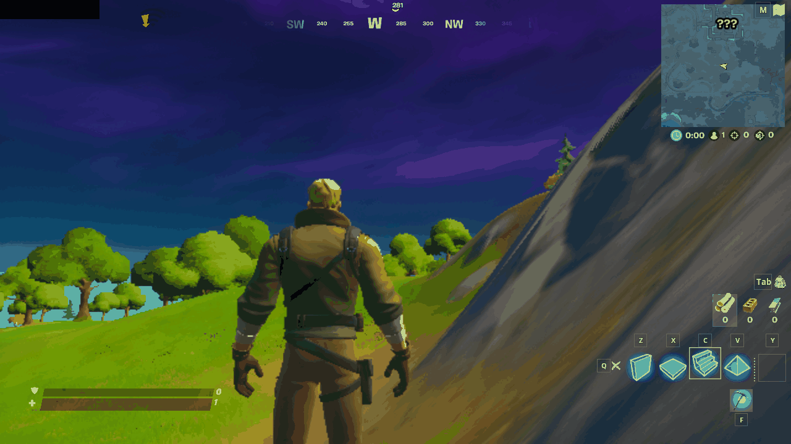

# Fortnite Chapter 2 Season 2 → Unreal Engine Project

Reconstructing Fortnite Chapter 2 Season 2 as an Unreal Engine project, with recovered C++ source, a dedicated server, and local backend services.

[Wiki](https://github.com/DistilledSlop/fortnite-12.60-reconstruction/wiki) ·
[Source reference](https://github.com/DistilledSlop/fortnite-12.60-reconstruction/wiki/Source-and-API-Index) ·
[Progress](#dedicated-server-progress) ·
[Setup](https://github.com/DistilledSlop/fortnite-12.60-reconstruction/wiki/Setup-and-Workflow)

<!-- badges:start -->

      

      

      

     

      

      

      

      

      

      

      

       

<!-- badges:end -->

The reference build is **12.60, CL 13477524**. The dedicated server runs on Unreal Engine 4.25 on Linux. The current goal is full server parity with the reference build. Reconstruction is ongoing.

## Run a local match

Run the reconstructed Linux dedicated server and local backend, then connect with the original 12.60 client. You can join a match, jump from the Battle Bus, and land on Apollo. Full-match gameplay is still in development. [Setup and workflow](https://github.com/DistilledSlop/fortnite-12.60-reconstruction/wiki/Setup-and-Workflow)

## Scope

- Reconstruct dedicated-server behavior, including match flow, gameplay, world simulation, and replication.
- Reconstruct the local account, profile, matchmaking, session, party, and XMPP services.
- Verify server behavior with the original 12.60 client. Rebuilding the client is deferred.

## Documentation

The [wiki](https://github.com/DistilledSlop/fortnite-12.60-reconstruction/wiki) collects project setup, architecture, source and API guides, Maps & World documentation, and subsystem guides linked to detailed source evidence.

| Start here | Contents |
|---|---|
| [Project status](https://github.com/DistilledSlop/fortnite-12.60-reconstruction/wiki/Project-Status) | Current limitations and acceptance milestones |
| [Source and API index](https://github.com/DistilledSlop/fortnite-12.60-reconstruction/wiki/Source-and-API-Index) | Source layout, recovery conventions, and code references |
| [Maps and world](https://github.com/DistilledSlop/fortnite-12.60-reconstruction/wiki/Maps-and-world) | Apollo, streaming, terrain, wind, and remaining integration |
| [Documentation index](https://github.com/DistilledSlop/fortnite-12.60-reconstruction/wiki/Documentation-Index) | Project and subsystem guides |

## Dedicated-server progress

[Detailed server board and evidence](docs/progress/server/index.html) · [Original client + server board](docs/combined.html)

## Repository

| Path | Contents |
|---|---|
| [porting/native](porting/native) | Unreal Engine project, generated classes, recovered implementations, and plugins |
| [porting/behavior](porting/behavior) | Function implementations, manifests, and recovery evidence |
| [porting/frontend](porting/frontend) | Frontend and lobby reconstruction |
| [porting/server](porting/server) | Local backend services |
| [porting/asset_pipeline](porting/asset_pipeline) and [porting/material_pipeline](porting/material_pipeline) | Asset conversion tools |
| [porting/progress](porting/progress) | Dashboard and evidence accounting |

The repository contains reconstruction code, tools, and documentation. The supplied game files, Unreal Engine checkout, extracted assets, build products, and encryption keys stay outside Git. See [.gitignore](.gitignore).
